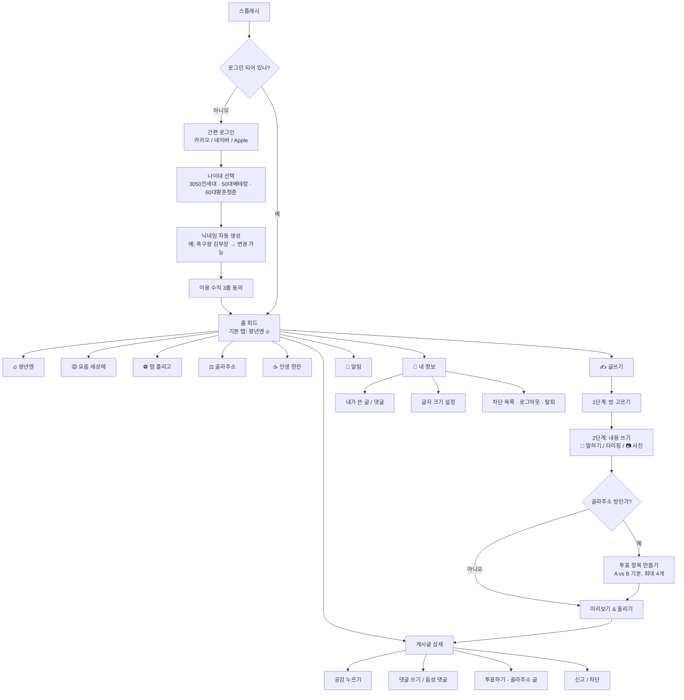
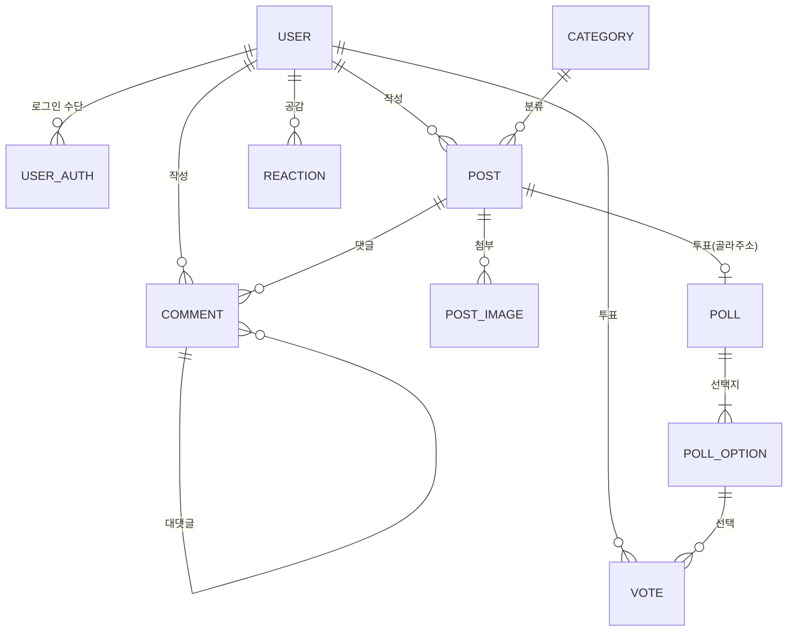

# MZ는가라, 왕년엔 — 앱 설계서 v0.1

> 5060 액티브 시니어를 위한 익명 커뮤니티 앱
> 산출물: ① 화면 흐름도(User Flow) ② DB 테이블 설계 ③ 프론트엔드 컴포넌트 구조 (+ 시니어 UI/UX 가이드)

---

## 0. 설계 원칙 요약

| 원칙 | 구체 기준 |
|---|---|
| **한 화면 = 한 가지 일** | 화면마다 핵심 행동(CTA)은 1개만. 보조 기능은 뒤로 숨긴다. |
| **왕폰트** | 본문 최소 18pt, 제목 22~26pt, 버튼 라벨 20pt. 시스템 글자 크기 설정 존중 + 앱 내 `크게/아주 크게` 2단계 추가 |
| **큼직한 터치 영역** | 모든 터치 대상 최소 **56×56dp** (일반 권장 44dp보다 크게), 버튼 사이 간격 12dp 이상 |
| **아이콘 + 글자 병기** | 아이콘만 있는 버튼 금지. `🎤 말하기`, `✍️ 글쓰기`처럼 항상 텍스트 라벨 동반 |
| **고대비** | 텍스트 대비 7:1(WCAG AAA) 목표. 회색 글씨 최소화 |
| **되돌리기 쉬움** | 삭제·신고 등 위험 행동은 확인 팝업 + "되돌리기" 토스트 5초 |
| **제스처 최소화** | 스와이프·길게 누르기에 핵심 기능을 두지 않는다. 모든 기능은 눈에 보이는 버튼으로 접근 가능 |

---

## 1. 주요 화면 흐름도 (User Flow)

### 1-1. 전체 흐름



### 1-2. 하단 탭바 (4개 고정)

| 탭 | 역할 |
|---|---|
| 🏠 **홈** | 상단 카테고리 5개 탭 + 카드형 피드 |
| ✍️ **글쓰기** | 가운데, 가장 크고 눈에 띄는 색 버튼 |
| 🔔 **알림** | 내 글에 달린 댓글·공감·투표 마감 |
| 👤 **내 정보** | 내 글, 설정, 글자 크기 |

> 검색은 홈 상단 우측 `🔍 찾기` 버튼(텍스트 병기)으로 둔다. 탭을 5개 이상 두지 않는 것이 핵심.

### 1-3. 핵심 시나리오별 흐름

**A. 첫 가입 (목표: 60초 이내, 탭 5회 이내)**
1. `카카오로 3초 만에 시작하기` 탭
2. 카카오 동의 화면 → 복귀
3. 나이대 3개 중 큰 카드 하나 탭 (생년월일 입력 없음, 자기 선언형)
4. 자동 생성 닉네임 확인 → `이대로 좋아요` 탭
5. 이용 수칙(정치·종교 비방 금지, 개인정보 노출 금지, 서로 존중) 3줄 → `알겠습니다` 탭 → 홈

**B. 음성으로 글쓰기**
1. ✍️ 글쓰기 → 방 선택(5개 큰 카드)
2. 본문 영역 아래 **화면 폭 가득한 `🎤 눌러서 말하기` 버튼**
3. 말하는 동안 파형 애니메이션 + 실시간 받아쓰기 텍스트 표시, `다 말했어요` 버튼으로 종료
4. 변환 결과를 편집창에 삽입 → 고칠 부분만 손으로 수정
5. 제목은 비워두면 본문 첫 문장으로 자동 제안
6. `올리기` → 게시 완료 토스트 "글이 올라갔어요! 👏"

**C. 골라주소 투표 참여**
1. 피드에서 투표 카드 확인 (A/B 버튼이 카드에 바로 노출)
2. 피드에서 바로 한 번 탭으로 투표 → 즉시 결과 막대그래프 + 퍼센트
3. 나이대별 결과 보기 (`50대베테랑은 72%가 A`) → 댓글 참여 유도

---

## 2. 데이터베이스 설계

PostgreSQL 기준. 익명 커뮤니티이므로 **소셜 계정 식별자와 공개 프로필을 분리**하고, 외부에 노출되는 것은 닉네임·나이대뿐이다.

### 2-1. ERD



### 2-2. 테이블 상세

#### `users` — 회원 (공개 프로필)

| 컬럼 | 타입 | 제약 | 설명 |
|---|---|---|---|
| id | BIGSERIAL | PK | |
| nickname | VARCHAR(20) | UNIQUE, NOT NULL | 자동 생성 후 변경 가능 (월 1회 제한) |
| age_group | VARCHAR(16) | NOT NULL, CHECK | `SANDWICH_3050`(3050낀세대) / `VETERAN_50`(50대베테랑) / `TWILIGHT_60`(60대황혼청춘) |
| avatar_emoji | VARCHAR(8) | DEFAULT '🙂' | 사진 대신 이모지 아바타 (익명성) |
| font_scale | SMALLINT | DEFAULT 1 | 0=보통, 1=크게, 2=아주 크게 (기기 간 동기화) |
| status | VARCHAR(12) | DEFAULT 'ACTIVE' | `ACTIVE` / `SUSPENDED` / `WITHDRAWN` |
| created_at | TIMESTAMPTZ | DEFAULT now() | |
| last_active_at | TIMESTAMPTZ | | |

#### `user_auths` — 소셜 로그인 연결 (비공개)

| 컬럼 | 타입 | 제약 | 설명 |
|---|---|---|---|
| id | BIGSERIAL | PK | |
| user_id | BIGINT | FK → users.id | |
| provider | VARCHAR(10) | NOT NULL | `KAKAO` / `NAVER` / `APPLE` |
| provider_uid | VARCHAR(128) | NOT NULL | 소셜 측 고유 ID |
| created_at | TIMESTAMPTZ | DEFAULT now() | |
| | | UNIQUE(provider, provider_uid) | |

> 이메일·전화번호·실명은 **저장하지 않는다**. 소셜 로그인에서 받지 않는 것이 익명성과 개인정보 리스크 모두에 유리.

#### `categories` — 게시판(방)

| 컬럼 | 타입 | 제약 | 설명 |
|---|---|---|---|
| id | SMALLSERIAL | PK | |
| slug | VARCHAR(20) | UNIQUE | `wangnyeon`, `yojeum`, `ttam`, `golla`, `insaeng` |
| name | VARCHAR(20) | NOT NULL | 왕년엔, 요즘 세상에, 땀 흘리고, 골라주소, 인생 한잔 |
| emoji | VARCHAR(8) | | 🔥 😡 ⚽ ⚖️ ☕ |
| description | VARCHAR(100) | | 방 소개 한 줄 |
| sort_order | SMALLINT | | 탭 순서 |
| allow_images | BOOLEAN | DEFAULT true | |
| requires_poll | BOOLEAN | DEFAULT false | 골라주소만 true |
| color_hex | CHAR(7) | | 탭/뱃지 색상 |

초기 데이터:

| slug | name | emoji | allow_images | requires_poll |
|---|---|---|---|---|
| wangnyeon | 왕년엔 | 🔥 | true (강조) | false |
| yojeum | 요즘 세상에 | 😡 | true | false |
| ttam | 땀 흘리고 | ⚽ | true | false |
| golla | 골라주소 | ⚖️ | true | **true** |
| insaeng | 인생 한잔 | ☕ | true | false |

#### `posts` — 게시글

| 컬럼 | 타입 | 제약 | 설명 |
|---|---|---|---|
| id | BIGSERIAL | PK | |
| user_id | BIGINT | FK → users.id | |
| category_id | SMALLINT | FK → categories.id | |
| title | VARCHAR(60) | NOT NULL | |
| body | TEXT | NOT NULL | |
| input_method | VARCHAR(8) | DEFAULT 'TYPING' | `TYPING` / `VOICE` / `MIXED` — STT 사용률 분석용 |
| author_age_group | VARCHAR(16) | NOT NULL | 작성 시점 나이대 스냅샷 (피드 뱃지 표시, 조인 절감) |
| like_count | INT | DEFAULT 0 | 비정규화 카운터 |
| comment_count | INT | DEFAULT 0 | 비정규화 카운터 |
| view_count | INT | DEFAULT 0 | |
| status | VARCHAR(12) | DEFAULT 'PUBLISHED' | `PUBLISHED` / `HIDDEN`(신고 누적) / `DELETED` |
| created_at | TIMESTAMPTZ | DEFAULT now() | |
| updated_at | TIMESTAMPTZ | | |

인덱스: `(category_id, status, created_at DESC)` — 탭별 최신 피드, `(category_id, like_count DESC)` — 인기글, `(user_id, created_at DESC)` — 내가 쓴 글

#### `post_images` — 첨부 사진

| 컬럼 | 타입 | 제약 | 설명 |
|---|---|---|---|
| id | BIGSERIAL | PK | |
| post_id | BIGINT | FK → posts.id ON DELETE CASCADE | |
| url | TEXT | NOT NULL | 오브젝트 스토리지 경로 |
| width / height | INT | | 피드 레이아웃 깜빡임 방지 |
| sort_order | SMALLINT | | 최대 5장 |

> 업로드 시 **EXIF(GPS 위치) 제거** 필수 — 익명성 보호.

#### `polls` — 투표 (골라주소 글 1:1)

| 컬럼 | 타입 | 제약 | 설명 |
|---|---|---|---|
| id | BIGSERIAL | PK | |
| post_id | BIGINT | FK → posts.id, UNIQUE | 게시글당 투표 1개 |
| question | VARCHAR(80) | | 비우면 글 제목 사용 |
| ends_at | TIMESTAMPTZ | | 기본 24시간 후, 선택: 1시간/하루/3일 |
| total_votes | INT | DEFAULT 0 | |
| allow_change | BOOLEAN | DEFAULT true | 마감 전 표 바꾸기 허용 |

#### `poll_options` — 투표 선택지

| 컬럼 | 타입 | 제약 | 설명 |
|---|---|---|---|
| id | BIGSERIAL | PK | |
| poll_id | BIGINT | FK → polls.id ON DELETE CASCADE | |
| label | VARCHAR(30) | NOT NULL | 예: "10만원", "15만원" |
| sort_order | SMALLINT | | A=0, B=1 … (2~4개) |
| vote_count | INT | DEFAULT 0 | |

#### `votes` — 투표 기록

| 컬럼 | 타입 | 제약 | 설명 |
|---|---|---|---|
| id | BIGSERIAL | PK | |
| poll_id | BIGINT | FK → polls.id | |
| option_id | BIGINT | FK → poll_options.id | |
| user_id | BIGINT | FK → users.id | |
| voter_age_group | VARCHAR(16) | NOT NULL | 나이대별 결과 집계용 스냅샷 |
| created_at | TIMESTAMPTZ | DEFAULT now() | |
| | | **UNIQUE(poll_id, user_id)** | 1인 1표 |

> 나이대별 결과: `SELECT option_id, voter_age_group, COUNT(*) FROM votes WHERE poll_id=$1 GROUP BY 1,2`. 트래픽이 커지면 `poll_option_age_stats` 집계 테이블로 분리.

#### `comments` — 댓글

| 컬럼 | 타입 | 제약 | 설명 |
|---|---|---|---|
| id | BIGSERIAL | PK | |
| post_id | BIGINT | FK → posts.id | |
| user_id | BIGINT | FK → users.id | |
| parent_id | BIGINT | FK → comments.id, NULL | 대댓글 (**1단계까지만** — 깊은 스레드는 시니어에게 혼란) |
| body | VARCHAR(1000) | NOT NULL | |
| input_method | VARCHAR(8) | DEFAULT 'TYPING' | |
| author_age_group | VARCHAR(16) | NOT NULL | |
| voted_option_id | BIGINT | FK → poll_options.id, NULL | 골라주소: "A 찍은 사람" 뱃지 표시 → 참견 댓글 재미 요소 |
| like_count | INT | DEFAULT 0 | |
| status | VARCHAR(12) | DEFAULT 'PUBLISHED' | |
| created_at | TIMESTAMPTZ | DEFAULT now() | |

인덱스: `(post_id, created_at)`

#### 보조 테이블 (MVP 필수)

| 테이블 | 핵심 컬럼 | 용도 |
|---|---|---|
| `reactions` | user_id, target_type(`POST`/`COMMENT`), target_id, type(`LIKE`=공감), UNIQUE(user_id, target_type, target_id) | 공감 |
| `reports` | reporter_id, target_type, target_id, reason(`ABUSE`/`SPAM`/`PERSONAL_INFO`/`POLITICS`), status | 신고 → 일정 수 누적 시 자동 `HIDDEN` |
| `blocks` | blocker_id, blocked_id | 차단한 사람의 글·댓글 숨김 |
| `notifications` | user_id, type, actor_id, post_id, is_read, created_at | 알림 탭 |

---

## 3. 프론트엔드 컴포넌트 구조

**React Native (Expo + TypeScript)** 기준으로 작성. Flutter로 가도 계층은 동일하게 옮길 수 있도록 오른쪽에 대응 위젯을 함께 적었다.

### 3-1. 폴더 구조

```
src/
├── app/                      # 화면 (expo-router 파일 기반 라우팅)
│   ├── (auth)/
│   │   ├── login.tsx                 # 간편 로그인
│   │   ├── age-group.tsx             # 나이대 선택
│   │   ├── nickname.tsx              # 닉네임 확인
│   │   └── rules.tsx                 # 이용 수칙 동의
│   ├── (tabs)/
│   │   ├── _layout.tsx               # 하단 탭바
│   │   ├── home.tsx                  # 카테고리 탭 + 피드
│   │   ├── write.tsx                 # 글쓰기 진입
│   │   ├── notifications.tsx
│   │   └── me.tsx
│   ├── post/[id].tsx                 # 게시글 상세
│   ├── write/[category].tsx          # 글 작성 폼
│   └── settings/font-size.tsx
├── components/
│   ├── foundation/           # 디자인 시스템 원자 컴포넌트
│   ├── feed/
│   ├── post/
│   ├── poll/
│   ├── comment/
│   ├── composer/
│   └── layout/
├── hooks/                    # useSpeechToText, useFontScale, useFeed ...
├── theme/                    # tokens.ts (색·글자·간격)
├── api/                      # API 클라이언트, React Query 훅
└── store/                    # 인증·설정 전역 상태 (Zustand)
```

### 3-2. 컴포넌트 트리

```
App
├── ThemeProvider (fontScale, 고대비 색상 토큰)
├── QueryClientProvider
└── Router
    ├── AuthStack
    │   ├── LoginScreen
    │   │   ├── AppLogo
    │   │   └── SocialLoginButton ×3 (kakao / naver / apple)
    │   ├── AgeGroupScreen
    │   │   └── AgeGroupCard ×3 (이모지 + 이름 + 한 줄 설명, 화면 폭 가득)
    │   ├── NicknameScreen
    │   │   ├── NicknamePreview
    │   │   └── BigButton ("이대로 좋아요" / "다시 뽑기")
    │   └── RulesScreen
    │
    └── MainTabs (BottomTabBar)
        ├── HomeScreen
        │   ├── HomeHeader (앱 이름 + 🔍 찾기)
        │   ├── CategoryTabBar
        │   │   └── CategoryTab ×5 (이모지 + 이름, 가로 스크롤 없이 균등 분할 or 2줄)
        │   ├── FeedSortToggle ("최신순" | "인기순")
        │   └── FeedList (FlashList)
        │       ├── PostCard
        │       │   ├── AuthorRow (Avatar · 닉네임 · AgeBadge · 몇 분 전)
        │       │   ├── PostTitle (22pt, 최대 2줄)
        │       │   ├── PostImagePreview (1장 크게, 2장↑이면 "+N")
        │       │   ├── PostBodyPreview (18pt, 3줄)
        │       │   └── PostStatsRow (❤️ 공감 N · 💬 댓글 N)
        │       ├── PollPostCard (골라주소 전용 — PostCard 확장)
        │       │   ├── AuthorRow
        │       │   ├── PostTitle
        │       │   ├── PollWidget  ← 피드에서 바로 투표
        │       │   └── PostStatsRow
        │       ├── EmptyFeed ("첫 글의 주인공이 되어보세요")
        │       └── FeedLoadingSkeleton
        │
        ├── WriteTab → CategoryPickerScreen
        │   └── CategoryPickCard ×5
        │
        ├── NotificationsScreen
        │   └── NotificationItem
        │
        └── MeScreen
            ├── ProfileSummary
            ├── MenuRow (내가 쓴 글 / 내 댓글 / 글자 크기 / 차단 목록 / 로그아웃)
            └── FontScalePreview

PostDetailScreen
├── DetailHeader (← 뒤로 · ⋯ 신고/차단)
├── AuthorRow
├── PostTitle (26pt)
├── PostBody (전문, 20pt)
├── PostImageGallery (탭 → 전체 화면 확대 + 핀치줌)
├── PollWidget (골라주소일 때)
│   ├── PollOptionButton ×2~4
│   ├── PollResultBar ×2~4 (투표 후 / 마감 후)
│   ├── AgeGroupResultToggle ("나이대별로 보기")
│   └── PollDeadline ("마감까지 3시간")
├── ReactionBar (❤️ 공감 큰 버튼 · 💬 댓글로 이동)
├── CommentList
│   └── CommentItem
│       ├── AuthorRow (+ VotedOptionBadge "A 찍음")
│       ├── CommentBody
│       ├── CommentActions (공감 · 답글)
│       └── ReplyList → CommentItem (1단계)
└── CommentComposer (하단 고정)
    ├── TextInput (18pt, 자동 높이)
    ├── MicButton
    └── SendButton

ComposeScreen (write/[category])
├── StepIndicator ("1. 방 고르기 ✓  2. 쓰기")
├── SelectedCategoryChip (탭하면 방 변경)
├── TitleInput ("제목 (안 쓰면 첫 문장으로 정해져요)")
├── BodyInput
├── VoiceInputPanel  ← 핵심
│   ├── MicHeroButton (폭 100%, 높이 72dp, "🎤 눌러서 말하기")
│   ├── ListeningIndicator (파형 + "듣고 있어요…")
│   ├── LiveTranscript
│   └── StopButton ("다 말했어요")
├── ImageAttachRow (📷 사진 넣기 · 썸네일 · ✕ 삭제)
├── PollEditor (골라주소일 때만)
│   ├── PollOptionInput ×2 (+ "선택지 추가" 최대 4)
│   └── DeadlinePicker (1시간 / 하루 / 3일 — 큰 세그먼트 버튼)
└── SubmitBar ("미리보기" · "올리기")
```

### 3-3. 공통 기반 컴포넌트 (`components/foundation`)

| 컴포넌트 | 역할 / 시니어 대응 포인트 | Flutter 대응 |
|---|---|---|
| `AppText` | `variant`(title/body/caption) × `fontScale` 자동 반영. 모든 텍스트는 반드시 이 컴포넌트 사용 | `Text` + `TextTheme` |
| `BigButton` | 최소 높이 56dp, 라벨 20pt, `primary/secondary/danger`. 눌림 상태 시각 피드백 + 햅틱 | `ElevatedButton` 커스텀 |
| `IconLabelButton` | 아이콘+텍스트 강제 (label prop 필수) | `TextButton.icon` |
| `TouchTarget` | 시각 크기와 무관하게 hitSlop으로 56dp 확보 | `SizedBox` + `InkWell` |
| `AgeBadge` | 나이대 뱃지 (색+글자) | `Chip` |
| `Avatar` | 이모지 아바타 | `CircleAvatar` |
| `ConfirmDialog` | 위험 행동 확인. 버튼 2개, "예/아니오" 대신 "삭제할게요/그만둘게요"처럼 행동을 문장으로 | `AlertDialog` |
| `Toast` | 하단 큰 토스트, 5초, 되돌리기 버튼 옵션 | `SnackBar` |
| `Screen` | SafeArea + 기본 여백 20dp + 뒤로가기 버튼 일관 배치 | `Scaffold` |

### 3-4. 핵심 훅 / 로직

| 훅 | 역할 |
|---|---|
| `useSpeechToText()` | `start() / stop() / transcript / isListening / error`. 기기 내장 음성인식(iOS Speech, Android SpeechRecognizer) 우선 사용 — `expo-speech-recognition` 등. 마이크 권한 거부 시 설정 이동 안내 화면 |
| `useFontScale()` | 시스템 글자 크기 × 앱 설정값 결합, 최대 배율 상한(레이아웃 깨짐 방지) |
| `useFeed(categorySlug, sort)` | React Query 무한 스크롤, 당겨서 새로고침 |
| `useVote(pollId)` | 낙관적 업데이트로 탭 즉시 결과 표시, 실패 시 롤백 + 토스트 |
| `useAuth()` | 소셜 로그인 토큰 → 자체 세션 토큰 교환, 자동 로그인 유지 |

### 3-5. 디자인 토큰 (`theme/tokens.ts`)

```ts
export const fontSize = {
  // fontScale: 0=보통, 1=크게(기본값), 2=아주 크게
  title:   [22, 24, 28],
  heading: [20, 22, 26],
  body:    [18, 20, 23],
  caption: [16, 17, 19], // 이보다 작은 글씨는 쓰지 않는다
  button:  [20, 20, 22],
};

export const space = { xs: 8, sm: 12, md: 16, lg: 20, xl: 28 };
export const minTouch = 56;
export const radius = { card: 16, button: 14 };

export const color = {
  bg: '#FFFDF8',          // 눈부심 줄인 따뜻한 흰색
  text: '#1A1A1A',
  textSub: '#4A4A4A',     // 연회색 금지 — 이 정도가 하한
  primary: '#E8590C',     // 글쓰기·주요 버튼 (주황)
  danger: '#C92A2A',
  border: '#D6D3CC',
  category: {
    wangnyeon: '#E8590C', // 🔥
    yojeum:    '#C92A2A', // 😡
    ttam:      '#2B8A3E', // ⚽
    golla:     '#5F3DC4', // ⚖️
    insaeng:   '#8B5E34', // ☕
  },
};
```

---

## 4. MVP 범위 제안

| 단계 | 포함 |
|---|---|
| **MVP (1차)** | 카카오 로그인, 나이대·닉네임, 5개 방 피드, 글쓰기(텍스트+사진+음성), 골라주소 투표(나이대별 결과 포함), 댓글 1단계, 공감, 신고·차단, 글자 크기 설정 |
| **2차** | 네이버·Apple 로그인, 알림 푸시, 인기글 주간 랭킹("이번 주 왕년의 전설"), 음성 댓글 |
| **3차** | 지역 기반 땀 흘리고 모임(동네 족구·등산 번개), 글 읽어주기(TTS) |

### 운영·안전 체크리스트
- 신고 누적 자동 숨김 + 운영자 검토 큐
- 금칙어 필터(욕설, 전화번호·계좌번호 패턴 → 개인정보 노출 및 사기 예방)
- 투자·코인·건강식품 홍보성 글 탐지 (시니어 타깃 사기 주의)
- 사진 EXIF 위치정보 제거
